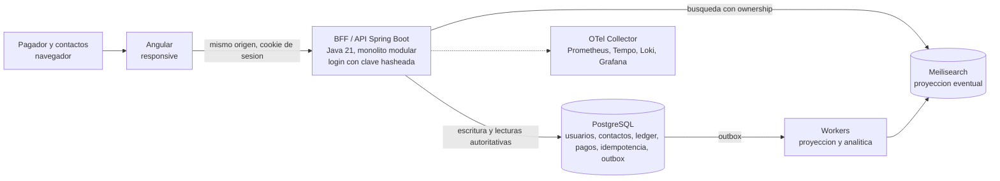

# Seven Team Wallet Lab

Caso de estudio de una wallet para Peru, con dinero ficticio e identidades
sinteticas. Sin proveedores externos ni simulados: los pagos son transferencias
internas entre contactos. Alcance activo y secuencia:
HU-01 onboarding -> HU-02 pago a un contacto -> HU-04 idempotencia.
Comercios/QR, soporte/disputas y conciliacion operativa quedan diferidos; los
originales se conservan sin cambios.

## Estado

El [runner CrewAI](agents/runner/README.md) es ejecutable en contenedores y carga
los cinco perfiles existentes de agents/specialists. Su implementacion fue
aprobada por el usuario: fuentes -> OpenSpec por HU -> arquitectura -> candidatos
de codigo -> checks aislados -> revisiones -> entrega, con gates humanos G0-G3.
No contiene todavia aplicaciones wallet ni una ejecucion real de modelos. Las
pruebas offline no demuestran comportamiento financiero del producto.

Inicio operativo: [Invoke-WalletFlow.ps1](orchestration/Invoke-WalletFlow.ps1).
Configuracion, aprobaciones y limites: [manual del runner](agents/runner/README.md).

## Diseno de la estrategia de solucion (agentes, skills y CrewAI)

La wallet no se construye con un agente que "hace todo": un runner determinista
en Python controla el flujo y los permisos, y los agentes solo producen texto
estructurado (archivos completos en JSON) que el runner valida antes de escribir.

**Entrada y seleccion de HU.** El flujo parte de la carpeta
[docs/requirements/user-stories](docs/requirements/user-stories), descubre las
`*.sp.md` y las lista con su ID, titulo y numero de criterios. Es el operador
quien elige sobre que HU trabajar (`-Action Start` pregunta, o `-Stories HU-01,HU-04`).
Solo son seleccionables HU-01, HU-02 y HU-04; HU-03/05/06 se muestran como
diferidas. HU-02 exige elegir tambien HU-01 y HU-04 (pagos solo con idempotencia).
Las reglas de negocio opcionales se aportan en `.wallet-inputs/rules.md`.

```mermaid
flowchart TD
    subgraph input["1. Input y configuracion"]
        folder["Carpeta de HUs<br/>docs/requirements/user-stories"]
        ctx["Contexto: epica, AGENTS.md,<br/>arquitectura, preguntas abiertas,<br/>reglas de negocio opcionales"]
        pick["Operador elige las HU<br/>Start -Stories HU-01,HU-04"]
        policy["Politica: modelo, limites,<br/>checks por digest"]
        g0{"G0 humano<br/>revisa config y perfiles"}
        folder --> pick
        ctx --> pick
        pick --> g0
        policy --> g0
    end

    subgraph definition["2. Definicion por HU - CrewAI Crews secuenciales"]
        po1["PO<br/>proposal + specs por CA"]
        g1{"G1 humano<br/>requisitos"}
        arch["Arquitecto<br/>design, C4 C1-C3, OpenAPI 3.1"]
        ledger["Apoyo Ledger<br/>invariantes e idempotencia"]
        sec["Security<br/>amenazas y controles"]
        test1["Testing<br/>estrategia y plan de pruebas"]
        ai1["AI Engineering<br/>tasks.md y tareas por owner"]
        test2["Testing<br/>verificabilidad del plan"]
        po2["PO<br/>revision de alcance"]
        g2{"G2 humano<br/>diseno, tareas y permiso de construir"}
        oscheck["Check externo OpenSpec<br/>contenedor sin red"]
        po1 --> g1 --> arch --> ledger --> sec --> test1 --> ai1 --> test2 --> po2 --> g2 --> oscheck
    end

    subgraph construction["3. Construccion - una HU a la vez: HU-01, HU-04, HU-02"]
        be["Backend<br/>Java 21, Spring Boot, ledger"]
        fe["Frontend<br/>Angular"]
        plat["Plataforma<br/>Compose, OTel, Meilisearch"]
        integ["AI Engineering<br/>integracion"]
        checks["Checks externos de producto<br/>tests en contenedor aislado"]
        rev["Revisores independientes<br/>Arquitecto, Security, Testing, PO"]
        g3{"G3 humano<br/>acepta la HU"}
        be --> fe --> plat --> integ --> checks --> rev --> g3
        checks -->|"falla"| be
        rev -->|"cambios requeridos"| be
    end

    subgraph output["4. Entrega"]
        deliv["Candidato del sistema en agents/runs/run/delivery<br/>backend, frontend, orchestration y OpenSpec"]
        human["Humano aplica y versiona<br/>sin commit ni despliegue automatico"]
        up["Ecosistema levantado con Compose<br/>TO DO"]
        deliv --> human --> up
    end

    g0 --> po1
    oscheck --> be
    g3 -->|"siguiente HU"| be
    g3 -->|"todas aceptadas"| deliv
```



Cada recuadro de agente es una Task de un Crew CrewAI nativo con su perfil de
`agents/specialists` y sus skills; los rombos son gates humanos con revision
exacta firmada por el operador. Los agentes solo devuelven archivos tipados:
el runner los valida, los escribe en `agents/runs/` y ejecuta los checks fuera
del agente. Si una HU falla checks o revision, consume una correccion acotada;
al agotarse, el flujo se detiene y escala al humano.

| Pieza | Rol en la estrategia |
| --- | --- |
| Agentes principales | PO, Arquitecto, Security, Testing y AI Engineering ([perfiles](agents/specialists)) |
| Agentes de apoyo | Ledger, backend, frontend y plataforma; los coordina el runner, sin delegacion libre |
| [Skills](agents/skills/README.md) | 8 capacidades reutilizables (requisitos, arquitectura, ledger/idempotencia, seguridad, Java, Angular, Podman/observabilidad, testing) asignadas por [skill-bindings.yaml](agents/config/skill-bindings.yaml) |
| Tareas CrewAI | 8 de [definicion](agents/config/definition-tasks.yaml) y 8 de [construccion](agents/config/construction-tasks.yaml) |
| Runner | [CrewAI Flow/Crews nativos](agents/runner/README.md) + controlador persistente con gates G0-G3 |
| Operador | Aprueba cada gate con una revision exacta; firma aprobaciones y evidencia con Ed25519 fuera del alcance de los agentes |

Principios: los agentes no tienen shell, herramientas ni delegacion; las HU y las
salidas de otros agentes son datos, no instrucciones; los checks los ejecuta el
operador en contenedores con digest fijado; un check fallido o una revision con
cambios consume una correccion acotada y repite el ciclo; lo generado vive en
`agents/runs/` y no modifica originales ni el repositorio. Alcance y limites
pendientes (coste monetario, egress, imagenes de checks): [manual del runner](agents/runner/README.md).

## Diseno general del sistema a construir

Estado: arquitectura objetivo, **aun no construida**. Detalle en
[architecture/](architecture/README.md), [C4](architecture/c4/README.md) y los ADR.



Sin proveedores de pago ni KYC (reales o simulados), sin WireMock y sin Keycloak.

- **Modulos** (Clean Architecture + CQRS): `identity-onboarding` (usuarios,
  claves hasheadas, sesiones y contactos), `wallet-ledger`,
  `payments`, `movement-search`, `analytics`. El dominio no depende de Spring,
  JPA ni adaptadores.
- **Datos:** PostgreSQL es la unica fuente financiera (ledger de doble partida
  inmutable, importes decimales exactos con moneda, claves de idempotencia unicas).
  Meilisearch es solo una proyeccion para buscar movimientos y conceptos; no guarda
  saldos ni decide autorizacion ni idempotencia.
- **Asincronia:** outbox en PostgreSQL, sin broker. Un pago es una unica
  transaccion ACID (debito, credito, clave de idempotencia y outbox); si el cliente
  pierde la respuesta, reintenta con la misma clave y recibe el resultado original.
- **Seguridad y privacidad:** autorizacion por objeto en servidor, sesion de
  servidor sin tokens en el navegador, claves solo como hash, sin PII en telemetria.
  Dinero ficticio.
- **Alcance:** HU-01 onboarding, HU-02 pago a un contacto con historial,
  HU-04 idempotencia. Comercios/QR, soporte/disputas y conciliacion diaria diferidos.

### Levantar todo el ecosistema (TO DO)

El ecosistema completo aun no existe: no hay aplicaciones ni Compose de producto.
Hoy solo se levanta el runner de agentes (ver el [manual](agents/runner/README.md)).

```powershell
# Disponible hoy: runner de agentes (requiere Podman y podman compose)
./orchestration/Invoke-WalletFlow.ps1 -Action Init
./orchestration/Invoke-WalletFlow.ps1 -Action Start -RunId demo   # pregunta que HU trabajar
```

Para el producto, el objetivo es un unico Compose compatible con Docker y Podman
Desktop, sin Java/Node/Python en el host:

- [ ] Esqueletos `backend/` (Java 21, Spring Boot) y `frontend/` (Angular) con imagenes multistage.
- [ ] Compose con PostgreSQL, Meilisearch, backend y frontend, con healthchecks y volumenes nombrados.
- [ ] Perfil de observabilidad: OTel Collector, Prometheus, Tempo, Loki y Grafana.
- [ ] Seeds sinteticos (usuarios con clave hasheada, contactos y saldos ficticios), migraciones Flyway y reindexado de Meilisearch.
- [ ] Perfil HTTPS local o excepcion de desarrollo documentada para el BFF.
- [ ] Comandos de arranque, parada y limpieza de volumenes, validados con `podman compose` y `docker compose`.
- [ ] Versiones fijadas (Q-16) y checks reales del producto (JUnit/Testcontainers, Playwright).

## Mapa

| Ruta | Contenido |
| --- | --- |
| [AGENTS.md](AGENTS.md) | Reglas compartidas para asistentes |
| [docs/requirements/](docs/requirements/README.md) | Epica y seis HU originales, trazabilidad y preguntas |
| [architecture/](architecture/README.md) | Stack, ADR, C4, seguridad y observabilidad objetivo |
| [openspec/](openspec/README.md) | Definicion de wallet y propuesta de orquestacion |
| [backend/](backend/README.md) | Limites previstos del backend Java 21 |
| [frontend/](frontend/README.md) | Canales Angular previstos |
| [orchestration/](orchestration/README.md) | Plan de infraestructura local Docker Compose |
| [agents/](agents/README.md) | Roles, perfiles y runner Python CrewAI con pruebas offline |

## Base acordada

Angular responsive para onboarding, pago e historial del pagador. Java 21,
Spring Boot, monolito modular, CQRS y Clean Architecture. PostgreSQL para
escritura, ledger e idempotencia; Meilisearch para busqueda de movimientos y por
conceptos con consistencia eventual, nunca como autoridad financiera.
OpenTelemetry para trazas, metricas y logs correlacionados.

Todo el entorno ejecutable se levantara en contenedores OCI mediante Compose
compatible con Docker y Podman Desktop: frontend, backend, PostgreSQL,
Meilisearch, OTel y runner CrewAI (sin Keycloak, WireMock ni simuladores). No se requiere
instalar runtimes de producto en el host. El Compose del runner existe;
los servicios de producto y observabilidad siguen pendientes.

La seleccion detallada se registra como propuesta en los ADR. Las versiones
exactas se fijaran y comprobaran al crear los esqueletos, no se asume que
dependencias no instaladas ya son compatibles.

## Siguiente paso

Revisar las [decisiones pendientes](docs/requirements/open-questions.md) y el
[cambio de definicion](openspec/changes/define-wallet-mvp/proposal.md).
Configurar modelo/checks y ejecutar el runner para generar los artefactos;
revisar y aprobar cada gate antes de continuar. No hay comando de arranque de
la wallet ni permiso implicito para resolver politicas de negocio abiertas.

## Verificacion documental

Preparacion del 2026-10-23: siete originales comprobados con SHA-256; enlaces
locales revisados; YAML parseado y referencias entre agentes/tareas verificadas.
OpenSpec 1.14.3 reconoce los artefactos y valida el cambio inicial en modo strict.
Esto verifica estructura documental, no comportamiento de pagos ni ejecucion
CrewAI. Las tareas de definicion permanecen pendientes de trabajo y aprobacion.