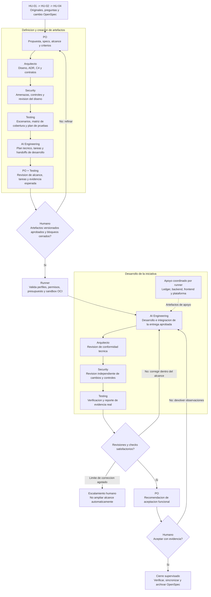

# Flujo CrewAI y gates humanos

Este documento describe el orden operativo implementado por el
[runner](../runner/README.md), con CrewAI Flow/Crews nativos y Compose OCI.
Alcance activo: HU-01 -> HU-02 -> HU-04; las demas HU siguen diferidas. La
aprobacion de implementacion del runner no aprueba gasto de modelos ni producto.

## Flujo de artefactos y desarrollo

El flujo principal usa cinco agentes especializados. Ledger, backend, frontend
y plataforma se conservan como apoyo; el runner los coordina explicitamente,
sin delegacion autonoma libre. El diagrama es el objetivo, no ejecucion disponible.

Si cambia materialmente el alcance, specs, diseno o tareas durante la correccion,
se invalida la aprobacion y se vuelve al gate de artefactos; no se continua con
la aprobacion anterior. No habilitar pagos antes de verificar idempotencia.

## Agentes y perfiles de instrucciones

| Agente principal | ID CrewAI | Perfil de instrucciones | Artefactos y responsabilidad |
| --- | --- | --- | --- |
| PO | product_analyst | [po.md](../specialists/po.md) | Proposal, specs, prioridades y recomendacion de aceptacion |
| AI Engineering | ai_engineer | [ai-engineering.md](../specialists/ai-engineering.md) | Plan tecnico, tareas, desarrollo e integracion |
| Testing | quality_reviewer | [testing.md](../specialists/testing.md) | Escenarios, cobertura, plan de pruebas y evidencia |
| Arquitecto | solution_architect | [architect.md](../specialists/architect.md) | Design, ADR, C4, contratos y conformidad |
| Security | security_reviewer | [security.md](../specialists/security.md) | Amenazas, controles y hallazgos de diseno/implementacion |

Los perfiles tienen estado `configured`; el runner los carga y calcula su revision.
G0 requiere revisarlos para el run concreto. Ese estado no es una aprobacion ni
concede permisos. No son archivos de agentes de Copilot ni se ejecutan por existir.

## Fases y configuraciones

| Fase | Configuracion | Permisos previstos |
| --- | --- | --- |
| Refinamiento/diseno | definition-tasks.yaml, secuencial | PO, Arquitecto, Security, Testing y AI Engineering; solo contexto sanitizado |
| Gate | Fuera de CrewAI, control humano/runner | Sin invocar modelo para decidir autorizacion |
| Construccion | construction-tasks.yaml, secuencial inicialmente | AI Engineering y apoyos; sandbox y allowlist por tarea aprobada |
| Revision | Arquitecto, Security y Testing con tareas de revision explicitas | Lectura de diff/evidencia; no alterar codigo revisado |
| Aceptacion/archivo | Responsable humano | No autoaceptar ni hacer commits/despliegues |

## Correspondencia con las tareas

| Etapa del diagrama | Tareas declarativas | Responsable |
| --- | --- | --- |
| Propuesta y specs | refine_requirements | PO |
| Diseno y controles | design_architecture, design_financial_integrity, review_security_design | Arquitecto, apoyo ledger y Security |
| Estrategia de verificacion | define_test_strategy | Testing |
| Plan tecnico | plan_delivery | AI Engineering |
| Revision antes del gate | plan_implementation, review_product_scope | Testing y PO |
| Desarrollo de apoyo | implement_backend, implement_frontend, implement_platform | Backend, frontend y plataforma |
| Integracion | integrate_initiative | AI Engineering |
| Conformidad y seguridad | review_architecture_implementation, review_security_implementation | Arquitecto y Security |
| Verificacion y recomendacion | verify_change, recommend_product_acceptance | Testing y PO |

Las tareas estan en los YAML de definicion/construccion; no ejecutan pasos por
su sola presencia. El gate humano queda fuera de las tareas LLM. Las rondas de
correccion y la invalidacion de aprobaciones son responsabilidad del futuro Flow.

## Estado minimo persistente a implementar

run_id, change_id, revision de artefactos, tareas permitidas, preguntas abiertas,
fase, presupuesto, estado de aprobacion y referencias de evidencia. El registro
de aprobacion se autentica fuera de prompts y esta vinculado a la revision.
El runner invalida la aprobacion si los artefactos cambian.

## Criterios de activacion

1. Configurar y revisar proveedor/modelo, presupuesto y egress externo antes de autorizar G0.
2. Preparar imagenes de checks por digest y criterios para sus comandos; la politica ejemplo no es ejecutable.
3. Resolver preguntas funcionales aplicables; el runner no las decide.
4. Autorizar por separado cada G1/G2/G3. G2 habilita construccion solo sobre la HU aprobada.
5. Verificar checks reales y revisar evidencias; no usar dobles offline como evidencia del producto.

Los callbacks o la memoria de CrewAI no sustituyen un control de permisos.
Las rondas de correccion deben tener limite; al agotarlo se escala al humano.