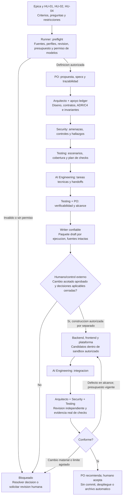

# Runner CrewAI

Estado: runner Python ejecutable en OCI, conectado a CrewAI 1.15.28 y a los
perfiles existentes en `agents/specialists/`. El usuario aprobo implementar el
flujo; esto no aprueba gasto LLM, construccion de la wallet, pagos, despliegue,
commit ni push. No se han hecho llamadas a modelos reales ni generado producto.
El cambio OpenSpec describe el alcance y sus [escenarios](../../openspec/changes/add-crewai-wallet-orchestration/specs/crewai-orchestration/spec.md).

Incluye controlador persistente con gates G0-G3 por HU, crews nativos, CLI,
Compose endurecido, aprobaciones versionadas y checks firmados en contenedores
externos. Las pruebas offline usan dobles y no son evidencia de comportamiento
financiero. La imagen de checks, el modelo y la politica monetaria requieren
configuracion del operador. El egress del proveedor necesita un control de red
externo; Compose no lo restringe.

## Arranque

Desde PowerShell, en la raiz del repositorio:

```powershell
./orchestration/Invoke-WalletFlow.ps1 -Action Init
```

Esto crea `.wallet-operator/operator.key` (privada, solo operador),
`.wallet-control/operator.pub` (publica, verificable por runner), la plantilla
`policy.json` y los directorios ignorados de control/salidas. No instala ni
solicita secretos.
Configurar la politica aprobada: modelo compatible con CrewAI, proveedor/base_url,
limites y checks. `policy.example.json` contiene digests placeholder y no permite
checks reales. No guardar claves API en Git ni en la politica; al autorizar un
modelo, entregar el secreto como variable del proceso PowerShell. Los limites
actuales son llamadas/tokens/tiempo/correcciones, no un tope monetario. No usar
claves de produccion sin egress allowlist externo aprobado. Reglas opcionales van
en `.wallet-inputs/rules.md`; deben ser ficticias y aprobadas.

### Proveedor personal GitHub Copilot SDK

CrewAI sigue orquestando el flujo; `copilot_sdk` solo responde como proveedor
LLM. La opcion viene desactivada: requiere `provider: "copilot_sdk"`,
`copilot_personal_use_approved: true`, modelo explicito y aprobacion firmada G0.
Q-15 debe quedar cerrada antes de activar ese flag. Por defecto el adaptador usa la
sesion del usuario ya autenticado en Copilot (`COPILOT_USE_LOGGED_IN_USER=true`) y
retira `COPILOT_GITHUB_TOKEN`, `GH_TOKEN` y `GITHUB_TOKEN` del entorno del SDK
para que un token ambiental no la sustituya. Con `COPILOT_USE_LOGGED_IN_USER=false`
exige `COPILOT_GITHUB_TOKEN` en el entorno del proceso (no pegarlo en comandos,
archivos, issues ni registros). Compose solo reenvia esa variable sin su valor.

Limite: la sesion iniciada con `copilot login` queda en el Administrador de
credenciales de Windows; un contenedor Linux no puede leerla. Para usarla, el
controlador ofrece `-HostRunner`, que ejecuta solo el servicio `runner` (el que
llama al LLM) en un venv Python 3.12 del host (`.wallet-venv/`, creado en el primer
uso con las dependencias fijadas de `pyproject.toml`). `operator` (firma,
aprobaciones, checks) sigue en contenedores y la clave privada no se entrega al
host runner:

```powershell
./orchestration/Invoke-WalletFlow.ps1 -Action Start -RunId demo -Stories HU-01 -HostRunner
./orchestration/Invoke-WalletFlow.ps1 -Action Resume -RunId demo -HostRunner
```

Es una excepcion explicita y opcional a "todo en contenedores": el proceso del host
tiene acceso al sistema de archivos del usuario (incluido `.wallet-operator/`), por
lo que pierde el aislamiento del runner en OCI. Usar solo con aprobacion Q-15 y datos
sinteticos. Verificado sin invocar modelos: el SDK autentica como el usuario del host
(`authType: user`) con los tokens ambientales retirados. Pendiente: probar un
`Start` real tras definir `policy.json` y cerrar Q-15.

El SDK recibe sesiones sin herramientas, instrucciones locales, skills, MCP,
memoria o telemetria. La imagen instala `github-copilot-sdk==1.0.26` y descarga
el runtime durante el build. Las pruebas de este cambio usan un cliente simulado:
no se ha realizado ninguna llamada con la suscripcion. La integracion no impone
un tope monetario ni garantiza `max_output_tokens`; ambos limites y el egress
deben resolverse en Q-15 antes de una ejecucion real. La autenticacion dentro
del contenedor tambien requiere validar la entrega segura del token.

```powershell
./orchestration/Invoke-WalletFlow.ps1 -Action Start -RunId demo
./orchestration/Invoke-WalletFlow.ps1 -Action Status -RunId demo
```

`Start` lista las HU encontradas en `docs/requirements/user-stories` (ID, titulo,
criterios y si son seleccionables) y pregunta sobre cuales trabajar; tambien se
puede indicar `-Stories HU-01,HU-04`. Solo HU-01, HU-02 y HU-04 son seleccionables;
las diferidas se muestran con su motivo. HU-02 exige incluir HU-01 y HU-04. El
runner rechaza un run sin seleccion explicita y solo procesa las HU elegidas
(`list-stories` y `start --select` en la CLI).

G0 espera revision humana de modelo, politica, perfiles y huellas. Revisar
artefactos en `agents/runs/<run>/` y autorizar la revision exacta:

```powershell
./orchestration/Invoke-WalletFlow.ps1 -Action Approve -RunId demo -Revision <sha256> -Reviewer <identificador>
```

G1 aprueba proposal/specs por HU; G2 aprueba arquitectura/tareas y autoriza
construccion; G3 acepta cada HU. `Resume` reanuda un run pausado. El controlador
ejecuta checks configurados por digest, con `--network=none`, rootfs de solo
lectura, usuario sin privilegios, recursos limitados y timeout; firma evidencia
y continua el flujo. Fallos de check o revisiones con cambios descartan salidas
de construccion/revision, consumen una correccion y repiten autores, checks y
revisores. Al agotar el limite se detiene. `Export` copia la entrega aceptada a
`agents/runs/<run>/delivery`; no escribe en el repositorio ni completa tareas.

Para corregir un gate, guardar observaciones en `.wallet-inputs/review.md` y usar
`-Action Revise -Story HU-01 -FeedbackFile .wallet-inputs/review.md`; agregar
`-Construction` para una correccion de codigo dentro de la HU activa. `Revoke`
revoca el gate actual o el indicado por `-Gate`. `Recover` requiere la decision
explicita del operador de reconocer una llamada incierta y continuar.

Rutas: `agents/runs/<run>/definition/openspec/changes/<change>/` contiene
borradores por HU; `workspace/` los candidatos; `delivery/` la exportacion tras
todos los G3. `.wallet-control/approvals/` y `evidence/` quedan fuera del volumen
escribible por agentes.

## Diseno y operacion

## Flujo de extremo a extremo



Los handoffs conservan el contexto aplicable y todas las dependencias validadas,
no solo el ultimo mensaje. Una correccion revalida los dependientes afectados.
El diagrama representa el orden implementado. Cada G1/G2/G3 espera aprobacion
humana ligada al SHA-256 de la revision; G0 valida perfiles/config antes de la
primera invocacion. La construccion prioriza HU-01, HU-04, HU-02.

## Python, configuraciones e instrucciones

| Pieza | Responsabilidad propuesta |
| --- | --- |
| [main.py](src/wallet_agents/main.py) | CLI para iniciar, aprobar, recuperar, checks y exportar |
| [flow.py](src/wallet_agents/flow.py) | Estado persistente, gates, limites, artefactos y CrewAI Flow nativo |
| [crew.py](src/wallet_agents/crew.py) | Factorias Agent/Task/Crew desde YAML, perfiles y skills |
| [contracts.py](src/wallet_agents/contracts.py) | Datos tipados de fuentes, alcance, presupuesto, artefactos, evidencia y checkpoints |
| [artifacts.py](src/wallet_agents/artifacts.py) | Rutas confinadas, locks, estado atomico y firmas Ed25519 |
| [agents.yaml](../config/agents.yaml) | Nueve roles, sin tools ni delegacion libre |
| [definition-tasks.yaml](../config/definition-tasks.yaml) | Ocho tareas desde requisitos hasta revision PO/Testing |
| [construction-tasks.yaml](../config/construction-tasks.yaml) | Ocho categorias desde construccion hasta recomendacion funcional |
| [skill-bindings.yaml](../config/skill-bindings.yaml) | Mapa propio de perfiles/skills; no pasarlo como campos nativos de Agent |

No se necesita un .py por agente. Las factorias crean objetos CrewAI nativos;
los perfiles Markdown y skills vinculados forman parte del contexto. La revision
de perfiles/config se vuelve a comprobar antes de cada efecto.

## Entradas y salidas por rol

Entrada comun: snapshot de [epica/HU/CA](../../docs/requirements/README.md),
[preguntas](../../docs/requirements/open-questions.md), restricciones y cambio
OpenSpec objetivo. Se conservan hashes y localizadores de criterios originales.

| Rol | Entradas adicionales | Destinos logicos de artefactos draft |
| --- | --- | --- |
| PO | Criterios y decisiones humanas | proposal, delta-specs, traceability, open-questions, scope-review |
| Arquitecto | Requisitos refinados y aporte ledger | design, api-contracts, data-contracts, adr-proposals, c4-proposals |
| Security | Diseno, datos y contratos | threat-model, controls, security-findings |
| Testing | Criterios, diseno y controles | scenarios, test-plan, coverage, plan-review, verification-report |
| AI Engineering | Artefactos validados de los anteriores | delivery-plan, proposed-openspec-tasks, handoffs, integration-report |
| Apoyos ledger/backend/frontend/plataforma | Tarea y contexto permitido | financial-invariants y candidatos/diffs de tareas expresamente autorizadas |

El runner valida rutas; el LLM devuelve archivos completos en JSON tipado, nunca
comandos. El plan debe cubrir todos los criterios con escenarios, rutas y checks.
Los textos quedan en el run y no modifican originales ni backlog. Ningun borrador
implica aprobacion, prueba o entrega real.

## Contrato minimo por ejecucion

- RunRequest: run/change, fase, HU ordenadas, fuentes/hashes, revision de config,
  tareas/CA/escenarios permitidos, rutas/checks, referencia de autorizacion y budget.
- ValidatedContext: contenido autorizado, revision, fuentes y outputs dependientes;
  no secretos ni permisos extraidos del texto de las HU.
- ArtifactEnvelope: productor/tarea, trazabilidad, revision, dependencias, destino
  logico, contenido, bloqueos y referencias de evidencia; siempre draft.
- EvidenceReference: diferencia planned/executed/failed/not_executed. Solo un
  registro del ejecutor confiable prueba una ejecucion sobre un snapshot concreto.
- AuthorizationScope: representacion de un registro externo ya autenticado; el
  objeto o su referencia no son una prueba de aprobacion por si mismos.
- RunCheckpoint: etapa y consumo acumulado; reanudar exige revalidar revision,
  autorizacion y efectos anteriores, sin resetear presupuestos.

## Limites de construccion

La fase definition no modifica producto. La fase construction selecciona solo
IDs del cambio aprobado, no ejecuta todas las HU por existir tareas genericas.
HU-01 -> HU-02 -> HU-04 se conserva; no se habilitan pagos sin idempotencia.

El runner genera candidatos en el volumen del run. El operador ejecuta checks
configurados por digest mediante [Invoke-WalletFlow.ps1](../../orchestration/Invoke-WalletFlow.ps1).
El agente no recibe shell, socket, credenciales ni escritura a control. Checks
usan red deshabilitada por defecto. El runner LLM necesita egress al proveedor y
Compose no lo filtra: el entorno debe imponer allowlist externa. No se han
validado imagenes Maven/npm/OpenSpec ni servicios wallet reales.

## Verificacion y limites

Verificado con Podman: build, `compose config`, `Init`, `Start` y `Status` llegan
a G0 sin llamadas. Nueve pruebas pasan en la imagen completa con `--network=none`,
incluyendo Crew/Flow nativos con un LLM fixture local, perfiles, aprobaciones,
correcciones y evidencia firmada. `wiring-smoke` fue solo smoke-test, sin aprobar
ni gastar. No se ejecutaron proveedores reales ni checks de producto.

La clave privada Ed25519 solo se monta en el servicio operador; el runner ve
clave publica/recibos y puede verificarlos, no firmarlos. El nombre de reviewer
no autentica por si mismo su identidad; la identidad sigue dependiendo del
operador local. No existe presupuesto monetario duro ni filtrado de egress.
Dependencias directas estan fijadas, pero faltan lock de transitive, SBOM y
digest de la imagen base del runner. `recover`
reconoce una llamada incierta sin reintentarla. `policy.example.json` tiene
placeholders y no activa checks. Q-15/Q-16 y preguntas funcionales siguen abiertas
donde corresponda. Activar requiere proveedor/modelo, coste y datos aprobados,
egress limitado, imagenes de checks por digest y gates humanos. No se certifica
seguridad/regulacion ni comportamiento de la wallet.