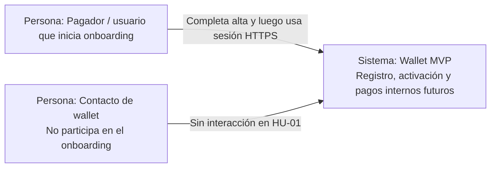
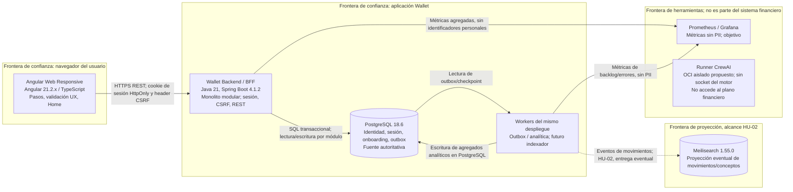
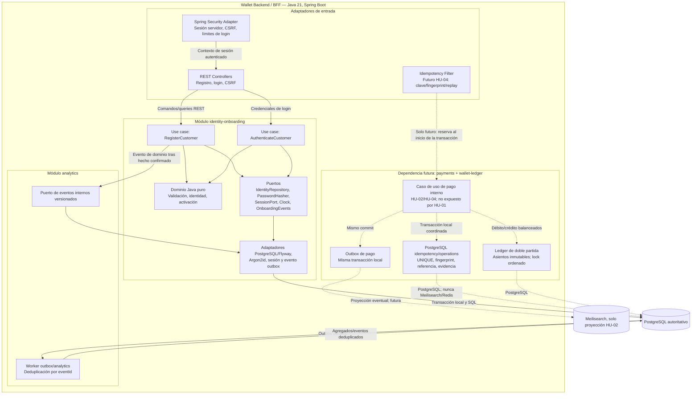

# Vistas C4 propuestas — HU-01 onboarding

Estado: arquitectura objetivo propuesta; no acredita código ni despliegue. HU-01 únicamente. Los elementos de pago/idempotencia aparecen como dependencias futuras HU-02/HU-04, no como alcance implementado. No se presenta C4 nivel 4.

## C1 — Contexto

No hay proveedor KYC, IdP, proveedor de pagos, sistema externo ni simulador. Contacto se muestra por continuidad del contexto de wallet; HU-01 no lo consulta.

## C2 — Contenedores

Angular no accede a PostgreSQL ni Meilisearch. Meilisearch no es fuente de verdad ni participa en HU-01. El objetivo OCI/Compose incluye apps, dependencias y observabilidad; runner futuro aislado. El estado Q-15 del laboratorio registra runner Copilot en host como riesgo aceptado: no se presenta aquí como OCI ya ejecutado y se propone una revisión para alinear el futuro entorno.

## C3 — Componentes del backend

Las flechas punteadas identifican diseño futuro, no operaciones habilitadas. Dominio Java puro no depende de Spring/JPA. Los módulos acceden a sus datos mediante sus puertos/adaptadores; no hay escritura cruzada de tablas. Filtro idempotente y soporte Flyway/retención/métricas/harness PostgreSQL se detallan en `../design.md`; su ejecución y las pruebas quedan pendientes de HU-04.
