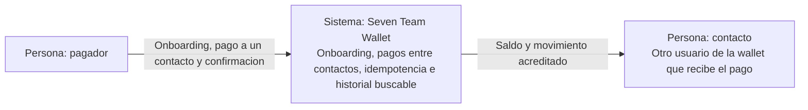
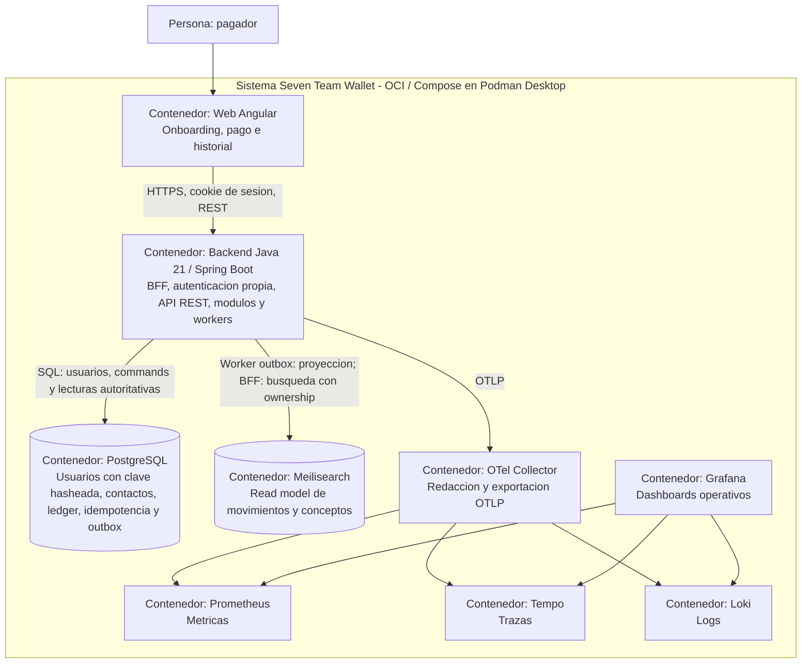
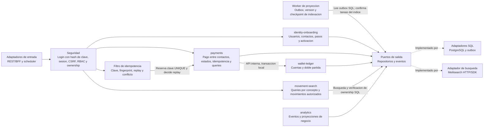

# Diagramas C4

Modelo objetivo, no despliegue existente. Diagramas Mermaid con notacion C4:
personas, sistema, contenedores y componentes con responsabilidades y tecnologias.
Sin sistemas externos: no hay proveedores de pago ni KYC, reales o simulados.
Alcance: HU-01 -> HU-02 -> HU-04. No se diagraman como activos comercios,
soporte/disputas ni conciliacion operativa. Todo nodo ejecutable se desplegara
en contenedores OCI con Compose compatible con Docker y Podman Desktop.

## Nivel 1: Contexto

## Nivel 2: Contenedores

PostgreSQL es tecnologia compartida, no licencia para compartir tablas entre
modulos. Las claves se guardan solo como hash en la tabla de usuarios; el
navegador recibe una cookie de sesion de servidor, sin tokens persistentes.
El worker no es un microservicio separado en este modelo.
Meilisearch no tiene acceso desde el navegador y no es autoridad financiera.
Su volumen es independiente del SQL. Un perfil de herramientas separado alojara
CrewAI y OpenSpec, sin acceso a datos financieros ni socket del motor.

## Nivel 3: Componentes del backend

Dentro de cada modulo: adaptadores -> application -> domain. Las flechas entre
componentes son colaboraciones, no dependencias del dominio sobre SQL. Analitica
consume eventos durables via worker; no condiciona el commit financiero.
El filtro de idempotencia es un componente del mismo backend (sin microservicio
ni broker); persiste claves en PostgreSQL, nunca en
Meilisearch ni memoria. El pago, la clave y el outbox se confirman en una sola
transaccion. Retencion y plazos siguen pendientes de Q-07.

## Vistas complementarias

CrewAI y OpenSpec son herramientas de desarrollo fuera del sistema de pagos:
el [flujo de agentes](../../agents/flows/README.md) no tiene acceso al ledger.
Nivel 4 (codigo) se agrega solo cuando exista codigo que diagramar. Al crear
Compose se anadira una vista de despliegue verificada con Podman Desktop y Docker.